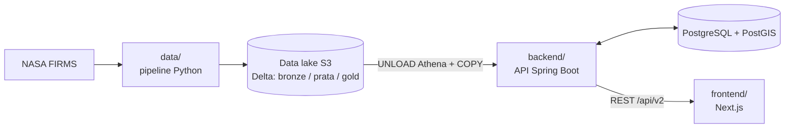

# Fire Atlas

Plataforma aberta para explorar focos de calor **MODIS e VIIRS** (NASA FIRMS), com atividade harmonizada entre
sensores e previsão de 7 dias por célula H3. Projeto do NASA Space Apps 2026, desafio
"Harmonization of MODIS and VIIRS Hot Spots". Sem login.



| Pasta | O que é | Stack | Documentação |
|---|---|---|---|
| [`data/`](data/) | Pipeline: normalização, lake Delta, harmonização MODIS/VIIRS, previsão XGBoost, job diário | Python 3.12, DuckDB, Delta Lake, uv | [`data/README.md`](data/README.md) |
| [`backend/`](backend/) | API REST: carga anual da gold para o PostGIS, consultas de mapa, calendário, análises e previsão | Java 21, Spring Boot, Flyway, Athena | [`backend/README.md`](backend/README.md) |
| [`frontend/`](frontend/) | Interface web: mapa, calendário, estatísticas e previsões | Next.js 16, React 19, MapLibre, React Query | [`frontend/README.md`](frontend/README.md) |

## Rodar com Docker

Requisitos: Docker com Compose v2. Java, Maven e Node não precisam estar instalados: os builds rodam dentro das imagens.

```bash
cp backend/.env.example backend/.env   # preencha DATALAKE_BUCKET, AWS_REGION e as chaves AWS
docker compose up -d --build
```

| Serviço | Endereço |
|---|---|
| Interface (`web`) | http://localhost:3000 |
| API (`api`) | http://localhost:8080, Swagger em http://localhost:8080/swagger-ui.html |
| PostGIS (`db`) | `localhost:5433`, banco/usuário/senha `fireatlas` |

Ao abrir a interface, o frontend dispara `POST /api/v2/bootstrap/2026`: a API exporta a grade de 2026 do data lake
via Athena e a grava no PostGIS. A barra de progresso só libera as telas quando a carga termina; depois a API carrega
os anos anteriores em segundo plano. Essa carga exige credenciais AWS válidas em `backend/.env`. Sem elas, a API sobe,
mas a tela de carga mostra o erro.

```bash
docker compose logs -f api   # acompanhar a carga
docker compose down          # parar (preserva o banco)
docker compose down -v       # parar e apagar o banco; a próxima carga recomeça do zero
```

### Configuração

| Onde | Variável | Padrão | Uso |
|---|---|---|---|
| `backend/.env` | `DATALAKE_BUCKET`, `AWS_REGION`, `AWS_ACCESS_KEY_ID`, `AWS_SECRET_ACCESS_KEY` | — | Acesso ao data lake e ao Athena. O perfil `~/.aws` do host não é montado no contêiner. |
| `backend/.env` | `ATHENA_*`, `BOOTSTRAP_*` | ver [`backend/.env.example`](backend/.env.example) | Ajuste da carga anual |
| shell ou `.env` na raiz | `NEXT_PUBLIC_API_URL` | `http://localhost:8080/api/v2` | URL da API **vista pelo navegador**; entra no bundle no build (exige `--build` ao mudar) |
| shell ou `.env` na raiz | `CORS_ORIGINS` | `http://localhost:3000` | Origens aceitas pela API; inclua o endereço público da interface ao publicar |

Dentro do compose, a API sempre usa `db:5432`; `DB_URL` do `backend/.env` só vale ao rodar a API fora do Docker.

Para servir em outro host, use o endereço público nas duas pontas, por exemplo:

```bash
NEXT_PUBLIC_API_URL=http://meu-host:8080/api/v2 CORS_ORIGINS=http://meu-host:3000 docker compose up -d --build
```

### Observações

- **ARM (Apple Silicon):** a imagem `postgis/postgis` só existe para amd64; o compose fixa `platform: linux/amd64`
  e o banco roda emulado, mais lento na carga anual. Os demais serviços têm imagem nativa.
- **Portas:** 3000, 8080 e 5433 precisam estar livres. Não rode este compose junto com os de `backend/` ou
  `frontend/`, que usam as mesmas portas.
- **Desligamento:** o cache anual fica em tabelas `UNLOGGED`. `docker compose stop/down` preserva os dados
  (o `db` tem 2 min para o checkpoint); uma queda abrupta esvazia o cache e a próxima visita recarrega 2026.
- O job diário do pipeline (`data/compose.yaml`) é independente desta stack e atualiza o data lake, não o banco local.

## Demo pública

**https://fire-atlas.duckdns.org**

A mesma stack do compose roda numa instância EC2 (`m6a.xlarge`, Ubuntu 24.04, `us-east-2`) criada pela stack
CloudFormation `fire-atlas-app`, que clona este repositório e sobe `docker compose`. Um Caddy na frente emite o
certificado HTTPS (Let's Encrypt) e roteia `/api/*` para a API e o resto para a interface, então front e API
ficam na mesma origem.

| Item | Valor |
|---|---|
| DNS | `fire-atlas.duckdns.org` → Elastic IP `18.189.223.70` (não muda ao parar/religar a instância) |
| Portas públicas | 80 (redireciona para 443), 443, 3000 e 8080; PostGIS não é exposto |
| Acesso à máquina | Sem SSH; Session Manager (`aws ssm start-session --target <instance-id>`) |
| Credenciais AWS | Role da instância (leitura do lake + Athena workgroup `fireatlas-api`); sem chaves no `.env` |

## Desenvolvimento sem Docker

Cada parte roda isolada; os comandos estão no README de cada pasta:

```bash
docker compose up -d db                       # só o PostGIS em localhost:5433
(cd backend && mvn spring-boot:run)           # API em :8080, lê backend/.env
(cd frontend && npm install && npm run dev)   # UI em :3000, lê frontend/.env (NEXT_PUBLIC_API_URL)
```

## Testes

```bash
(cd backend && mvn test)
(cd frontend && npm test && npm run lint && npx tsc --noEmit)
(cd data && uv sync --locked --python 3.12 && .venv/bin/python -m pytest -q)
```

## Licença

[MIT](LICENSE).
